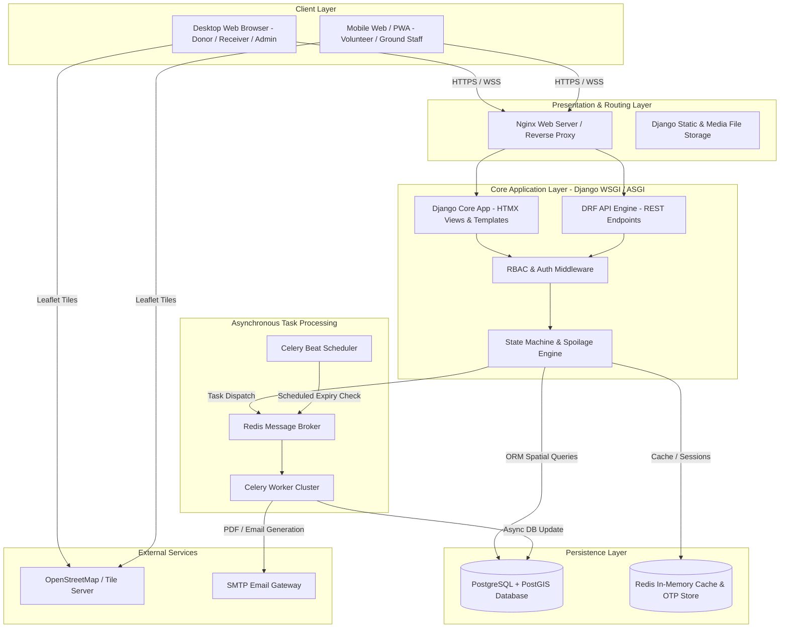
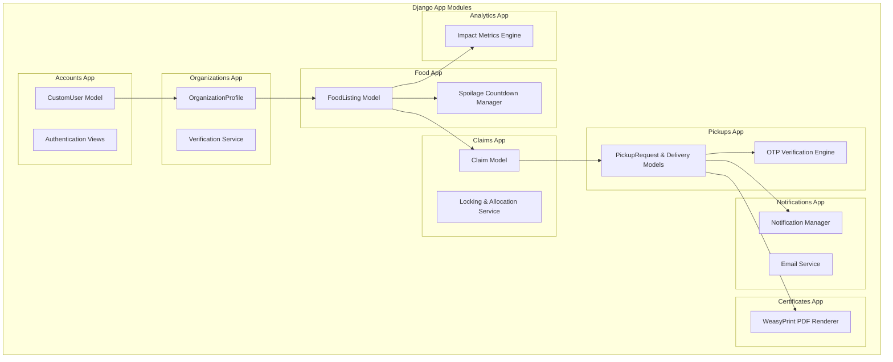
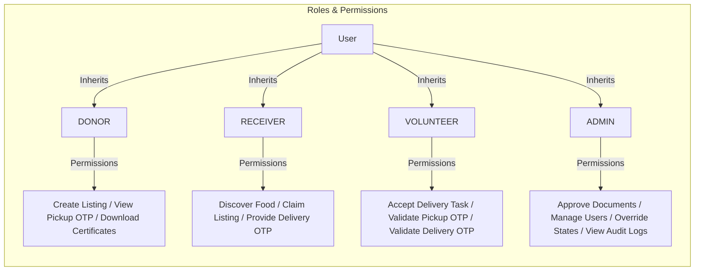
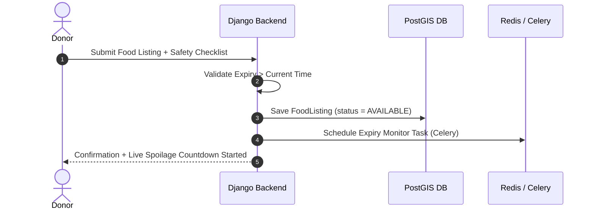
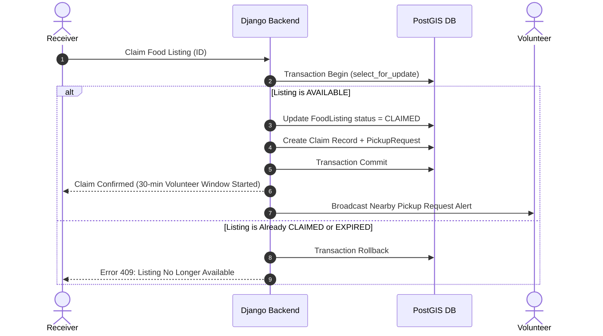
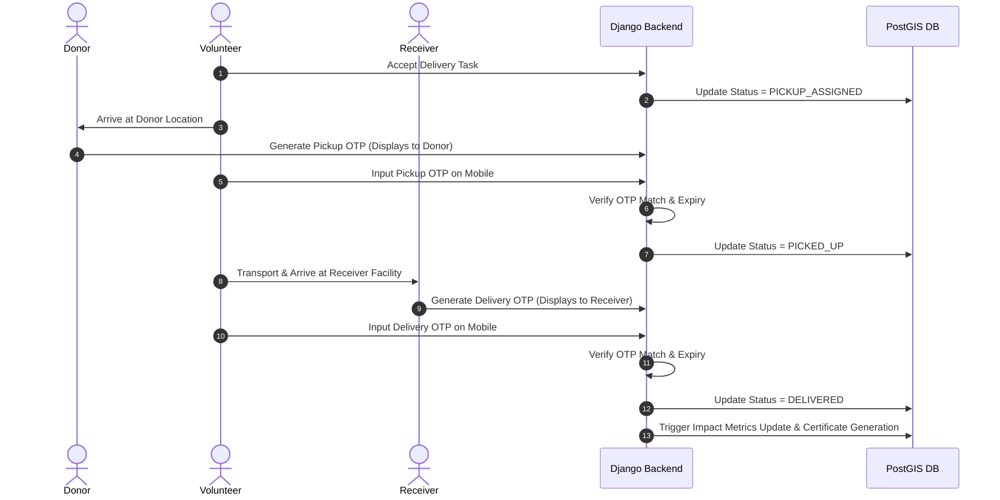
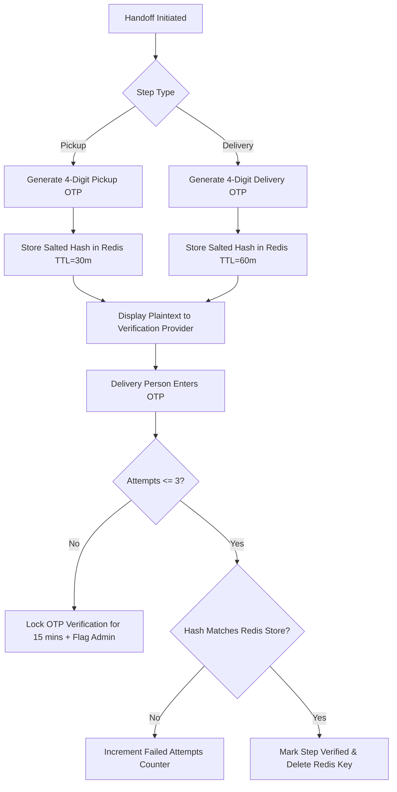
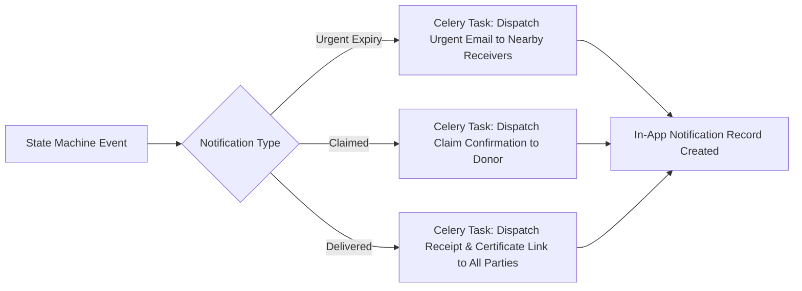
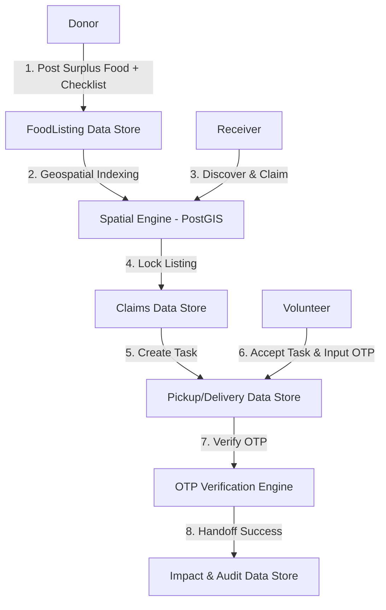

# SANJOG — System Design & Architecture Specification
## Technical Blueprint & Architectural Specification

---

### 1. ARCHITECTURE OVERVIEW
**SANJOG** is built as a high-performance, modular, multi-tenant monolithic architecture with API-first extensibility. It utilizes Django 5.x as the core web frame, Django REST Framework (DRF) for headless API integrations, PostgreSQL with PostGIS for spatial data indexing, Redis as an in-memory cache & Celery broker, and HTMX with Leaflet.js for interactive frontend rendering.

---

### 2. HIGH-LEVEL ARCHITECTURE (MERMAID)



---

### 3. COMPONENT DIAGRAM (MERMAID)



---

### 4. USER ROLE DIAGRAM (MERMAID)



---

### 5. FOOD DONATION FLOW (MERMAID)



---

### 6. CLAIM FLOW (MERMAID)



---

### 7. PICKUP & DELIVERY FLOW (MERMAID)



---

### 8. OTP FLOW (MERMAID)



---

### 9. NOTIFICATION FLOW (MERMAID)



---

### 10. DEPLOYMENT ARCHITECTURE (MERMAID)

```mermaid
graph TD
    subgraph Internet Edge
        DNS[Cloudflare / Route 53]
    end

    subgraph Application Server (VPS / Render / Railway)
        Nginx[Nginx Reverse Proxy & SSL Termination]
        Gunicorn[Gunicorn WSGI App Server - 4 Workers]
        CeleryWorker[Celery Task Worker Process]
        CeleryBeat[Celery Beat Scheduler Process]
    end

    subgraph Managed Database Services
        PostgresDB[(PostgreSQL 16 + PostGIS 3.4)]
        RedisCache[(Redis 7.x Cache & Broker)]
    end

    DNS --> Nginx
    Nginx --> Gunicorn
    Gunicorn --> PostgresDB
    Gunicorn --> RedisCache
    Gunicorn --> CeleryWorker
    CeleryBeat --> RedisCache
    CeleryWorker --> RedisCache
    CeleryWorker --> PostgresDB
```

---

### 11. DATA FLOW DIAGRAM (DFD LEVEL 1) (MERMAID)



---

### 12. REST API ARCHITECTURE & ENDPOINT BLUEPRINT

#### 12.1 Authentication Endpoints
| HTTP Method | Endpoint URL | Auth | Role | Request Body | Success Response | Validation Rules | Error Codes |
| :--- | :--- | :--- | :--- | :--- | :--- | :--- | :--- |
| **POST** | `/api/v1/auth/register/` | None | Any | `{username, email, password, role, phone}` | `201 Created` `{user_id, token}` | Email unique, password strong | `400` Bad Request |
| **POST** | `/api/v1/auth/login/` | None | Any | `{username, password}` | `200 OK` `{access, refresh, user}` | Credentials valid | `401` Unauthorized |
| **POST** | `/api/v1/auth/logout/` | JWT | Any | `{refresh_token}` | `205 Reset Content` | Token valid | `400` Bad Request |
| **GET** | `/api/v1/users/me/` | JWT | Any | None | `200 OK` User profile details | Must be logged in | `401` Unauthorized |

#### 12.2 Organization Endpoints
| HTTP Method | Endpoint URL | Auth | Role | Request Body | Success Response | Validation Rules | Error Codes |
| :--- | :--- | :--- | :--- | :--- | :--- | :--- | :--- |
| **GET** | `/api/v1/organizations/` | JWT | Admin | None | `200 OK` List of orgs | Admin access | `403` Forbidden |
| **POST** | `/api/v1/organizations/` | JWT | Donor/Receiver | `{name, reg_number, address, lat, lon, docs}` | `201 Created` Org profile | Reg number unique, files valid | `400` Validation Err |
| **PATCH** | `/api/v1/organizations/<id>/verify/` | JWT | Admin | `{status: "VERIFIED"|"REJECTED", notes}` | `200 OK` Updated status | Status in enum | `403` Forbidden |

#### 12.3 Food Listing Endpoints
| HTTP Method | Endpoint URL | Auth | Role | Request Body | Success Response | Validation Rules | Error Codes |
| :--- | :--- | :--- | :--- | :--- | :--- | :--- | :--- |
| **GET** | `/api/v1/food/` | None/JWT | Any | Query params: `radius`, `lat`, `lon` | `200 OK` GeoJSON/List | Radius 1..50km | `400` Bad Request |
| **POST** | `/api/v1/food/` | JWT | Verified Donor | `{title, servings, expiry_time, safety_checked: true}` | `201 Created` Food object | Safety checklist required | `403` Unverified |
| **GET** | `/api/v1/food/nearby/` | JWT | Receiver | Query params: `lat`, `lon`, `radius_km` | `200 OK` Filtered listings | PostGIS ST_DWithin query | `400` Invalid Coords |

#### 12.4 Claims & Pickup Endpoints
| HTTP Method | Endpoint URL | Auth | Role | Request Body | Success Response | Validation Rules | Error Codes |
| :--- | :--- | :--- | :--- | :--- | :--- | :--- | :--- |
| **POST** | `/api/v1/claims/` | JWT | Verified Receiver | `{food_listing_id, self_pickup: bool}` | `201 Created` Claim object | Listing status = AVAILABLE | `409` Already Claimed |
| **POST** | `/api/v1/pickups/<id>/verify-pickup/` | JWT | Volunteer/Donor | `{otp_code: "1234"}` | `200 OK` Status = PICKED_UP | Max 3 attempts, unexpired | `422` Invalid OTP |
| **POST** | `/api/v1/pickups/<id>/verify-delivery/` | JWT | Volunteer/Receiver | `{otp_code: "5678"}` | `200 OK` Status = DELIVERED | Max 3 attempts, unexpired | `422` Invalid OTP |

#### 12.5 Analytics & Certificates Endpoints
| HTTP Method | Endpoint URL | Auth | Role | Request Body | Success Response | Validation Rules | Error Codes |
| :--- | :--- | :--- | :--- | :--- | :--- | :--- | :--- |
| **GET** | `/api/v1/analytics/impact/` | None/JWT | Any | None | `200 OK` Total meals, weight, deliveries | Public view | `200` OK |
| **GET** | `/api/v1/certificates/<id>/download/` | JWT | Donor/Admin | None | `200 OK` PDF File Stream | Certificate exists | `404` Not Found |

---

### 13. DATABASE ARCHITECTURE (POSTGIS SPECIFICATION)
- **Spatial Reference System:** WGS 84 (`EPSG:4326`).
- **Spatial Field Types:** `gis_models.PointField(srid=4326, geography=True)`.
- **Spatial Indexing:** GiST (Generalized Search Tree) indexes on location columns (`CREATE INDEX idx_food_location ON food_foodlisting USING GIST (location);`).

---

### 14. BACKGROUND PROCESSING ARCHITECTURE (CELERY & REDIS)
- **Worker Queues:**
  1. `default`: General asynchronous operations.
  2. `expiry_queue`: High-priority periodic food listing expiry monitoring.
  3. `notifications`: Email rendering and SMTP dispatch.
  4. `certificates`: PDF generation via WeasyPrint.
- **Beat Periodic Schedules:**
  - `check-food-expirations`: Runs every 60 seconds.
  - `clean-expired-otps`: Runs every 15 minutes.
  - `aggregate-daily-analytics`: Runs daily at 00:00 UTC.

---

### 15. AUTHENTICATION & AUTHORIZATION ARCHITECTURE
- Custom Django Permissions Classes:
  - `IsVerifiedDonor`: Checks `request.user.role == 'DONOR'` and `request.user.organization.verification_status == 'VERIFIED'`.
  - `IsVerifiedReceiver`: Checks `request.user.role == 'RECEIVER'` and `request.user.organization.verification_status == 'VERIFIED'`.
  - `IsVolunteer`: Checks `request.user.role == 'VOLUNTEER'`.
  - `IsAdminUser`: Checks `request.user.is_staff` or `request.user.role == 'ADMIN'`.

---

### 16. SECURITY ARCHITECTURE
- **CSRF:** Standard Django CSRF token enforcement for session frontend; JWT headers (`Authorization: Bearer <token>`) for API.
- **Data Protection:** Media root directory protected from direct script execution; user upload filenames randomized using UUIDs.
- **Audit Logging:** Database-driven `AuditLog` table capturing actor, action string, target model ID, timestamp, and IP address.

---

### 17. LOGGING & MONITORING
- Standard Python `logging` configuration writing to:
  - `logs/sanjog_info.log` (Info events, claims, deliveries)
  - `logs/sanjog_security.log` (Failed logins, document approvals, OTP failures)
  - `logs/sanjog_error.log` (Unhandled exceptions, 500 errors)
