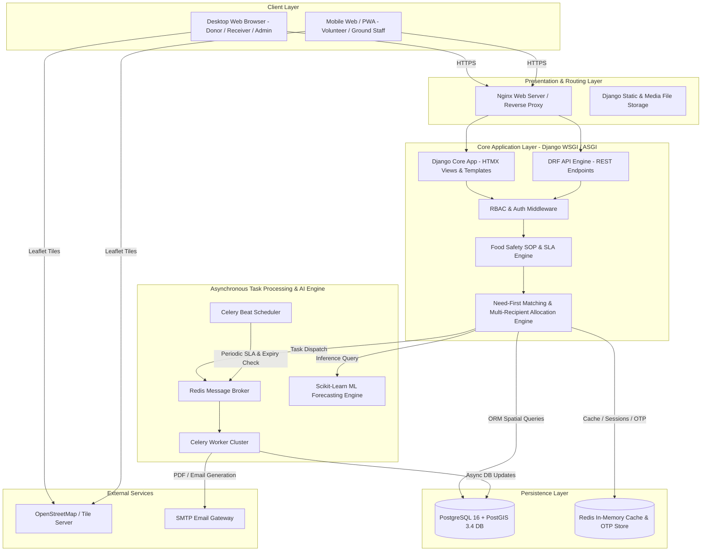
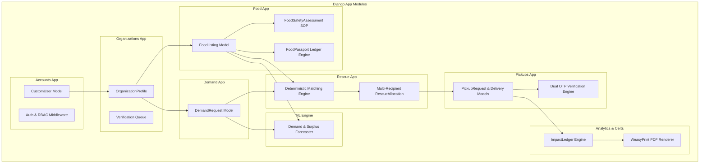
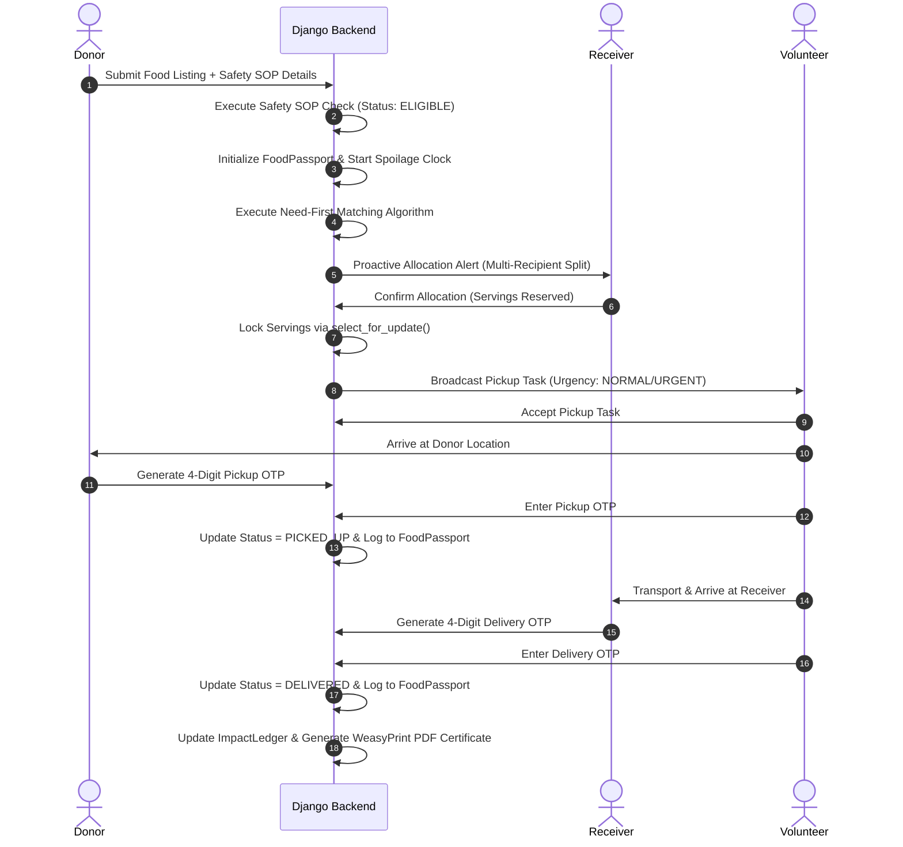
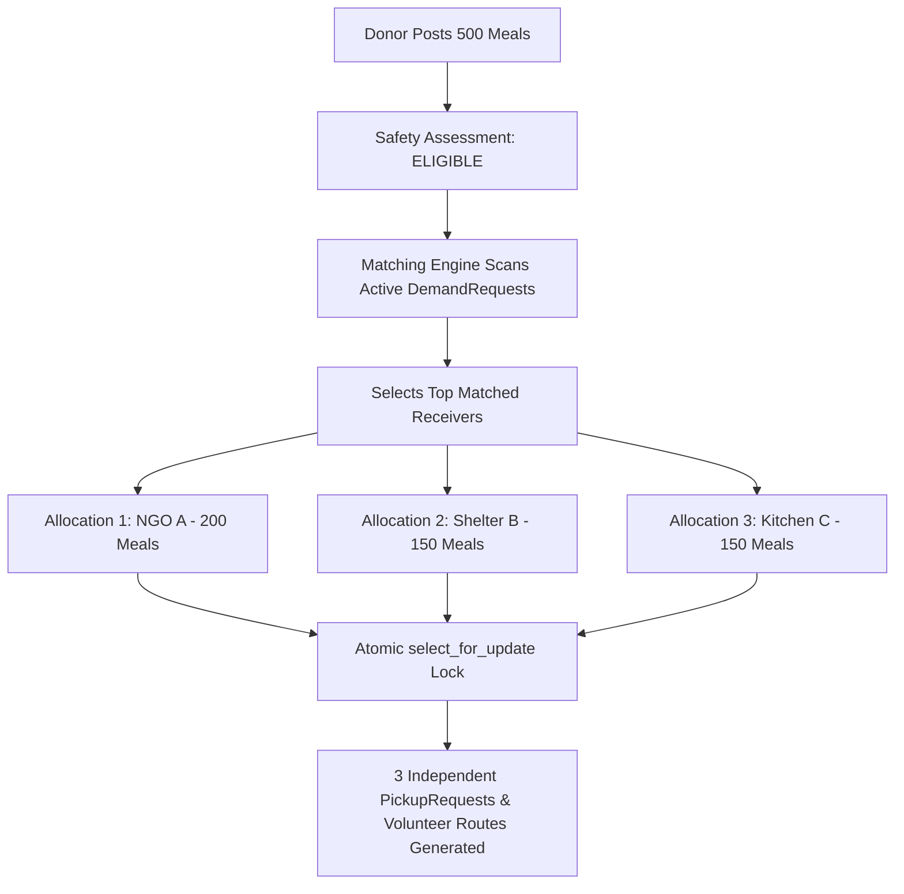
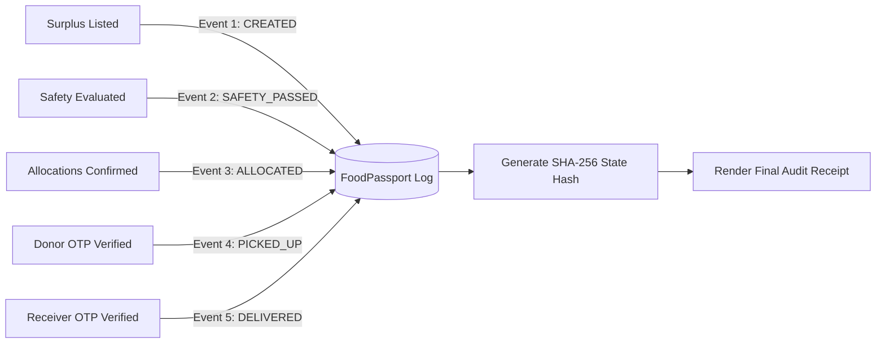

# SANJOG — System Design & Architecture Specification
## Technical Blueprint & Architectural Specification

---

### 1. ARCHITECTURE OVERVIEW
**SANJOG** is architected as an **Intelligent Food Rescue Operating System (Food Rescue OS)**. It uses a high-performance modular Django 5.x core, Django REST Framework (DRF) for headless APIs, PostgreSQL with PostGIS for spatial spatial indexing, Redis as an in-memory cache & Celery task broker, and HTMX with Leaflet.js for real-time frontend interactivity.

---

### 2. HIGH-LEVEL ARCHITECTURE (MERMAID)



---

### 3. COMPONENT DIAGRAM (MERMAID)



---

### 4. END-TO-END FOOD RESCUE FLOW (MERMAID)



---

### 5. MULTI-RECIPIENT ALLOCATION FLOW (MERMAID)



---

### 6. FOOD PASSPORT LEDGER FLOW (MERMAID)



---

### 7. REST API ENDPOINT BLUEPRINT

#### 7.1 Demand & Matching Endpoints
| HTTP Method | Endpoint URL | Auth | Role | Request Body | Success Response | Validation Rules | Error Codes |
| :--- | :--- | :--- | :--- | :--- | :--- | :--- | :--- |
| **POST** | `/api/v1/demand/` | JWT | Verified Receiver | `{servings, food_type, required_by, lat, lon}` | `201 Created` Demand object | Servings > 0, required_by in future | `400` Validation Err |
| **GET** | `/api/v1/demand/active/` | JWT | Admin/System | Query params: `lat`, `lon`, `radius_km` | `200 OK` List of active demands | PostGIS spatial radius lookup | `400` Bad Request |
| **POST** | `/api/v1/rescue/match/` | JWT | System/Admin | `{food_listing_id}` | `200 OK` Ranked matched demand list | Listing must be AVAILABLE | `404` Not Found |
| **POST** | `/api/v1/rescue/allocations/` | JWT | Receiver/System | `{food_listing_id, demand_request_id, servings}` | `201 Created` Allocation object | Atomic reservation check | `409` Conflict |

#### 7.2 Food & Food Passport Endpoints
| HTTP Method | Endpoint URL | Auth | Role | Request Body | Success Response | Validation Rules | Error Codes |
| :--- | :--- | :--- | :--- | :--- | :--- | :--- | :--- |
| **POST** | `/api/v1/food/` | JWT | Verified Donor | `{title, servings, cooked_at, expires_at, safety_sop}` | `201 Created` Listing + Safety result | Safety SOP complete | `400` Safety Failed |
| **GET** | `/api/v1/food/<id>/passport/` | JWT | Any | None | `200 OK` Complete Passport JSON + Hash | Valid listing ID | `404` Not Found |

#### 7.3 Logistics, OTP & Impact Endpoints
| HTTP Method | Endpoint URL | Auth | Role | Request Body | Success Response | Validation Rules | Error Codes |
| :--- | :--- | :--- | :--- | :--- | :--- | :--- | :--- |
| **POST** | `/api/v1/pickups/<id>/verify-pickup/` | JWT | Volunteer/Donor | `{otp_code: "1234"}` | `200 OK` Status = PICKED_UP | Max 3 attempts, unexpired | `422` Invalid OTP |
| **POST** | `/api/v1/pickups/<id>/verify-delivery/` | JWT | Volunteer/Receiver | `{otp_code: "5678"}` | `200 OK` Status = DELIVERED | Max 3 attempts, unexpired | `422` Invalid OTP |
| **GET** | `/api/v1/analytics/ledger/` | None/JWT | Any | None | `200 OK` Authoritative Impact JSON | Public feed | `200` OK |

---

### 8. DEPLOYMENT ARCHITECTURE (MERMAID)

```mermaid
graph TD
    subgraph Internet Edge
        DNS[Cloudflare / Route 53]
    end

    subgraph Application Server (VPS / Render / Railway)
        Nginx[Nginx Reverse Proxy & SSL Termination]
        Gunicorn[Gunicorn WSGI Server - 4 Workers]
        CeleryWorker[Celery Worker Cluster]
        CeleryBeat[Celery Beat Scheduler]
    end

    subgraph Database Layer
        Postgres[(PostgreSQL 16 + PostGIS 3.4 DB)]
        RedisCache[(Redis 7.x Cache & Broker)]
    end

    DNS --> Nginx
    Nginx --> Gunicorn
    Gunicorn --> Postgres
    Gunicorn --> RedisCache
    Gunicorn --> CeleryWorker
    CeleryBeat --> RedisCache
    CeleryWorker --> RedisCache
    CeleryWorker --> Postgres
```
