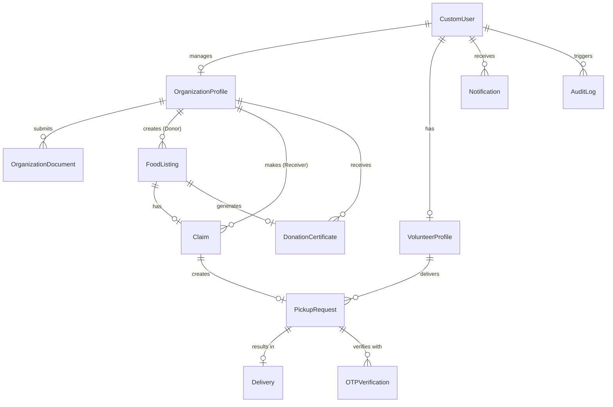

# SANJOG — Database Design & Data Dictionary Document
## Relational Schema & PostGIS Spatial Blueprint

---

### 1. DATABASE OVERVIEW
**SANJOG** utilizes PostgreSQL 16 with the PostGIS 3.4 spatial database extension. The database design strictly adheres to 3rd Normal Form (3NF), enforcing data integrity via relational foreign keys, check constraints, unique constraints, and spatial indexes.

---

### 2. ER DIAGRAM (MERMAID)



---

### 3. RELATIONAL SCHEMA & ENTITY LIST

#### Summary of Primary Entities:
1. `accounts_customuser` — Primary extended user model.
2. `organizations_organizationprofile` — Business/NGO legal entity profiles.
3. `organizations_organizationdocument` — Legal accreditation upload files.
4. `organizations_volunteerprofile` — Individual volunteer profiles.
5. `food_foodlisting` — Surplus food listings with PostGIS spatial coordinates.
6. `claims_claim` — Food claim transactions linking listing to receiver.
7. `pickups_pickuprequest` — Transport & pickup coordination records.
8. `pickups_otpverification` — Cryptographic handoff verification logs.
9. `pickups_delivery` — Completed delivery verification records.
10. `notifications_notification` — In-app notification log table.
11. `certificates_donationcertificate` — CSR PDF metadata and SHA256 hashes.
12. `analytics_impactrecord` — Daily & monthly aggregated platform metrics.
13. `audit_auditlog` — System-wide security & operational audit logs.

---

### 4. COMPREHENSIVE DATA DICTIONARY (TABLE SPECIFICATIONS)

#### Table 1: `accounts_customuser`
- **Purpose:** Stores core user authentication credentials and role flags.

| Field Name | Data Type | Nullable | Default | PK | FK | Unique | Index | Description |
| :--- | :--- | :--- | :--- | :--- | :--- | :--- | :--- | :--- |
| `id` | `UUID` | No | `uuid_generate_v4()` | Yes | No | Yes | Yes | Primary Key |
| `username` | `VARCHAR(150)` | No | None | No | No | Yes | Yes | Unique login username |
| `email` | `VARCHAR(254)` | No | None | No | No | Yes | Yes | Unique contact email |
| `password` | `VARCHAR(128)` | No | None | No | No | No | No | PBKDF2/Argon2 password hash |
| `role` | `VARCHAR(20)` | No | `'DONOR'` | No | No | No | Yes | Enum: `DONOR`, `RECEIVER`, `VOLUNTEER`, `ADMIN` |
| `phone_number` | `VARCHAR(15)` | No | None | No | No | Yes | Yes | Contact phone number |
| `is_email_verified`| `BOOLEAN` | No | `False` | No | No | No | No | Email verification status |
| `is_active` | `BOOLEAN` | No | `True` | No | No | No | No | Account status flag |
| `is_staff` | `BOOLEAN` | No | `False` | No | No | No | No | Admin panel permission |
| `date_joined` | `TIMESTAMPTZ` | No | `NOW()` | No | No | No | No | Registration timestamp |

---

#### Table 2: `organizations_organizationprofile`
- **Purpose:** Represents legal entities (Donors or Receivers) registered on the platform.

| Field Name | Data Type | Nullable | Default | PK | FK | Unique | Index | Description |
| :--- | :--- | :--- | :--- | :--- | :--- | :--- | :--- | :--- |
| `id` | `UUID` | No | `uuid_generate_v4()` | Yes | No | Yes | Yes | Primary Key |
| `user_id` | `UUID` | No | None | No | Yes | Yes | Yes | FK to `accounts_customuser.id` |
| `org_type` | `VARCHAR(20)` | No | None | No | No | No | Yes | Enum: `RESTAURANT`, `HOTEL`, `MESS`, `NGO`, `SHELTER`, `OTHER` |
| `name` | `VARCHAR(255)` | No | None | No | No | No | Yes | Legal organization name |
| `registration_number` | `VARCHAR(100)` | No | None | No | No | Yes | Yes | Tax / FSSAI / NGO Reg Number |
| `address_line1` | `VARCHAR(255)` | No | None | No | No | No | No | Street address |
| `city` | `VARCHAR(100)` | No | None | No | No | No | Yes | City name |
| `postal_code` | `VARCHAR(20)` | No | None | No | No | No | No | Postal PIN code |
| `location` | `GEOGRAPHY(POINT,4326)` | No | None | No | No | No | Yes (GiST) | PostGIS spatial coordinates |
| `verification_status` | `VARCHAR(20)` | No | `'PENDING'` | No | No | No | Yes | Enum: `PENDING`, `VERIFIED`, `REJECTED` |
| `rejection_reason` | `TEXT` | Yes | `NULL` | No | No | No | No | Admin notes if rejected |
| `created_at` | `TIMESTAMPTZ` | No | `NOW()` | No | No | No | No | Creation timestamp |

---

#### Table 3: `organizations_organizationdocument`
- **Purpose:** Stores paths and verification statuses of uploaded legal documents.

| Field Name | Data Type | Nullable | Default | PK | FK | Unique | Index | Description |
| :--- | :--- | :--- | :--- | :--- | :--- | :--- | :--- | :--- |
| `id` | `UUID` | No | `uuid_generate_v4()` | Yes | No | Yes | Yes | Primary Key |
| `organization_id` | `UUID` | No | None | No | Yes | No | Yes | FK to `organizations_organizationprofile.id` |
| `document_type` | `VARCHAR(50)` | No | None | No | No | No | No | Enum: `FSSAI_LICENSE`, `NGO_REGISTRATION`, `80G_CERTIFICATE`, `ID_PROOF` |
| `file_path` | `VARCHAR(500)` | No | None | No | No | No | No | Path to media file storage |
| `uploaded_at` | `TIMESTAMPTZ` | No | `NOW()` | No | No | No | No | Upload timestamp |
| `is_approved` | `BOOLEAN` | No | `False` | No | No | No | No | Approval status |

---

#### Table 4: `organizations_volunteerprofile`
- **Purpose:** Stores individual volunteer profiles and real-time availability.

| Field Name | Data Type | Nullable | Default | PK | FK | Unique | Index | Description |
| :--- | :--- | :--- | :--- | :--- | :--- | :--- | :--- | :--- |
| `id` | `UUID` | No | `uuid_generate_v4()` | Yes | No | Yes | Yes | Primary Key |
| `user_id` | `UUID` | No | None | No | Yes | Yes | Yes | FK to `accounts_customuser.id` |
| `vehicle_type` | `VARCHAR(30)` | No | `'WALKING'` | No | No | No | No | Enum: `WALKING`, `BICYCLE`, `TWO_WHEELER`, `CAR`, `VAN` |
| `is_available` | `BOOLEAN` | No | `True` | No | No | No | Yes | Real-time availability flag |
| `current_location`| `GEOGRAPHY(POINT,4326)` | Yes | `NULL` | No | No | No | Yes (GiST) | PostGIS spatial location |
| `total_deliveries`| `INTEGER` | No | `0` | No | No | No | No | Completed delivery counter |

---

#### Table 5: `food_foodlisting`
- **Purpose:** Core table representing surplus food entries created by Donors.

| Field Name | Data Type | Nullable | Default | PK | FK | Unique | Index | Description |
| :--- | :--- | :--- | :--- | :--- | :--- | :--- | :--- | :--- |
| `id` | `UUID` | No | `uuid_generate_v4()` | Yes | No | Yes | Yes | Primary Key |
| `donor_org_id` | `UUID` | No | None | No | Yes | No | Yes | FK to `organizations_organizationprofile.id` |
| `title` | `VARCHAR(200)` | No | None | No | No | No | No | Descriptive food title |
| `food_category` | `VARCHAR(30)` | No | None | No | No | No | Yes | Enum: `COOKED_MEAL`, `BAKERY`, `PACKAGED`, `RAW_INGREDIENT` |
| `food_type` | `VARCHAR(20)` | No | `'VEG'` | No | No | No | Yes | Enum: `VEG`, `NON_VEG`, `JAIN`, `VEGAN` |
| `quantity_kg` | `NUMERIC(8,2)` | No | None | No | No | No | No | Weight in kilograms |
| `estimated_servings`| `INTEGER` | No | None | No | No | No | No | Estimated number of people fed |
| `cooked_at` | `TIMESTAMPTZ` | No | None | No | No | No | No | Preparation timestamp |
| `expires_at` | `TIMESTAMPTZ` | No | None | No | No | No | Yes | Expiry cutoff timestamp |
| `pickup_address` | `TEXT` | No | None | No | No | No | No | Detailed pickup address |
| `location` | `GEOGRAPHY(POINT,4326)` | No | None | No | No | No | Yes (GiST) | PostGIS spatial point |
| `status` | `VARCHAR(20)` | No | `'AVAILABLE'` | No | No | No | Yes | Enum: `AVAILABLE`, `CLAIMED`, `PICKUP_ASSIGNED`, `PICKED_UP`, `DELIVERED`, `EXPIRED`, `CANCELLED` |
| `safety_checked` | `BOOLEAN` | No | `False` | No | No | No | No | Mandatory hygiene declaration flag |
| `image_path` | `VARCHAR(500)` | Yes | `NULL` | No | No | No | No | Path to uploaded food image |
| `created_at` | `TIMESTAMPTZ` | No | `NOW()` | No | No | No | Yes | Creation timestamp |

---

#### Table 6: `claims_claim`
- **Purpose:** Manages claim allocations by Receiver organizations.

| Field Name | Data Type | Nullable | Default | PK | FK | Unique | Index | Description |
| :--- | :--- | :--- | :--- | :--- | :--- | :--- | :--- | :--- |
| `id` | `UUID` | No | `uuid_generate_v4()` | Yes | No | Yes | Yes | Primary Key |
| `food_listing_id` | `UUID` | No | None | No | Yes | Yes | Yes | FK to `food_foodlisting.id` (1-to-1 active) |
| `receiver_org_id` | `UUID` | No | None | No | Yes | No | Yes | FK to `organizations_organizationprofile.id` |
| `claimed_at` | `TIMESTAMPTZ` | No | `NOW()` | No | No | No | No | Claim creation timestamp |
| `is_self_pickup` | `BOOLEAN` | No | `False` | No | No | No | No | Direct NGO pickup flag |
| `status` | `VARCHAR(20)` | No | `'ACTIVE'` | No | No | No | Yes | Enum: `ACTIVE`, `COMPLETED`, `CANCELLED` |

---

#### Table 7: `pickups_pickuprequest`
- **Purpose:** Tracks volunteer pickup dispatch and transport state.

| Field Name | Data Type | Nullable | Default | PK | FK | Unique | Index | Description |
| :--- | :--- | :--- | :--- | :--- | :--- | :--- | :--- | :--- |
| `id` | `UUID` | No | `uuid_generate_v4()` | Yes | No | Yes | Yes | Primary Key |
| `claim_id` | `UUID` | No | None | No | Yes | Yes | Yes | FK to `claims_claim.id` |
| `volunteer_id` | `UUID` | Yes | `NULL` | No | Yes | No | Yes | FK to `organizations_volunteerprofile.id` |
| `pickup_status` | `VARCHAR(20)` | No | `'UNASSIGNED'`| No | No | No | Yes | Enum: `UNASSIGNED`, `ASSIGNED`, `IN_TRANSIT`, `DELIVERED`, `FAILED` |
| `assigned_at` | `TIMESTAMPTZ` | Yes | `NULL` | No | No | No | No | Assignment timestamp |
| `picked_up_at` | `TIMESTAMPTZ` | Yes | `NULL` | No | No | No | No | Pickup completion timestamp |

---

#### Table 8: `pickups_otpverification`
- **Purpose:** Cryptographic verification logs for pickup and delivery handoffs.

| Field Name | Data Type | Nullable | Default | PK | FK | Unique | Index | Description |
| :--- | :--- | :--- | :--- | :--- | :--- | :--- | :--- | :--- |
| `id` | `UUID` | No | `uuid_generate_v4()` | Yes | No | Yes | Yes | Primary Key |
| `pickup_request_id`| `UUID` | No | None | No | Yes | No | Yes | FK to `pickups_pickuprequest.id` |
| `otp_type` | `VARCHAR(20)` | No | None | No | No | No | Yes | Enum: `PICKUP`, `DELIVERY` |
| `otp_hash` | `VARCHAR(255)` | No | None | No | No | No | No | Salted SHA-256 OTP hash |
| `attempts_count` | `INTEGER` | No | `0` | No | No | No | No | Failed validation count |
| `is_verified` | `BOOLEAN` | No | `False` | No | No | No | Yes | Verification status |
| `expires_at` | `TIMESTAMPTZ` | No | None | No | No | No | No | OTP expiration timestamp |

---

#### Table 9: `pickups_delivery`
- **Purpose:** Final delivery completion record.

| Field Name | Data Type | Nullable | Default | PK | FK | Unique | Index | Description |
| :--- | :--- | :--- | :--- | :--- | :--- | :--- | :--- | :--- |
| `id` | `UUID` | No | `uuid_generate_v4()` | Yes | No | Yes | Yes | Primary Key |
| `pickup_request_id`| `UUID` | No | None | No | Yes | Yes | Yes | FK to `pickups_pickuprequest.id` |
| `delivered_at` | `TIMESTAMPTZ` | No | `NOW()` | No | No | No | No | Delivery timestamp |
| `distance_km` | `NUMERIC(6,2)` | No | `0.00` | No | No | No | No | Calculated travel distance |
| `delivery_notes` | `TEXT` | Yes | `NULL` | No | No | No | No | Recipient comments |

---

#### Table 10: `certificates_donationcertificate`
- **Purpose:** Stores generated PDF metadata for corporate CSR validation.

| Field Name | Data Type | Nullable | Default | PK | FK | Unique | Index | Description |
| :--- | :--- | :--- | :--- | :--- | :--- | :--- | :--- | :--- |
| `id` | `UUID` | No | `uuid_generate_v4()` | Yes | No | Yes | Yes | Primary Key |
| `donor_org_id` | `UUID` | No | None | No | Yes | No | Yes | FK to `organizations_organizationprofile.id` |
| `food_listing_id` | `UUID` | No | None | No | Yes | Yes | Yes | FK to `food_foodlisting.id` |
| `certificate_hash` | `VARCHAR(64)` | No | None | No | No | Yes | Yes | SHA256 verification hash |
| `pdf_file_path` | `VARCHAR(500)` | No | None | No | No | No | No | PDF storage path |
| `generated_at` | `TIMESTAMPTZ` | No | `NOW()` | No | No | No | No | Generation timestamp |

---

#### Table 11: `audit_auditlog`
- **Purpose:** System-wide security and event auditing.

| Field Name | Data Type | Nullable | Default | PK | FK | Unique | Index | Description |
| :--- | :--- | :--- | :--- | :--- | :--- | :--- | :--- | :--- |
| `id` | `BIGSERIAL` | No | Nextval() | Yes | No | Yes | Yes | Primary Key |
| `user_id` | `UUID` | Yes | `NULL` | No | Yes | No | Yes | Actor user ID |
| `action` | `VARCHAR(100)` | No | None | No | No | No | Yes | Action string (e.g. `CLAIM_CREATED`) |
| `target_model` | `VARCHAR(100)` | No | None | No | No | No | No | Affected entity name |
| `target_id` | `VARCHAR(100)` | No | None | No | No | No | No | Affected entity UUID |
| `ip_address` | `INET` | Yes | `NULL` | No | No | No | No | Client IP address |
| `timestamp` | `TIMESTAMPTZ` | No | `NOW()` | No | No | No | Yes | Event timestamp |

---

### 5. STATE TRANSITION RULES & DATABASE CONSTRAINTS

#### FoodListing State Transitions:
```
AVAILABLE ──► CLAIMED ──► PICKUP_ASSIGNED ──► PICKED_UP ──► DELIVERED
   │             │
   ▼             ▼
EXPIRED      CANCELLED
```

#### SQL Check Constraints:
```sql
-- Enforce non-negative food quantities
ALTER TABLE food_foodlisting ADD CONSTRAINT chk_food_quantity CHECK (quantity_kg > 0);
ALTER TABLE food_foodlisting ADD CONSTRAINT chk_food_servings CHECK (estimated_servings > 0);

-- Enforce valid OTP failure count limit
ALTER TABLE pickups_otpverification ADD CONSTRAINT chk_otp_attempts CHECK (attempts_count <= 3);
```
