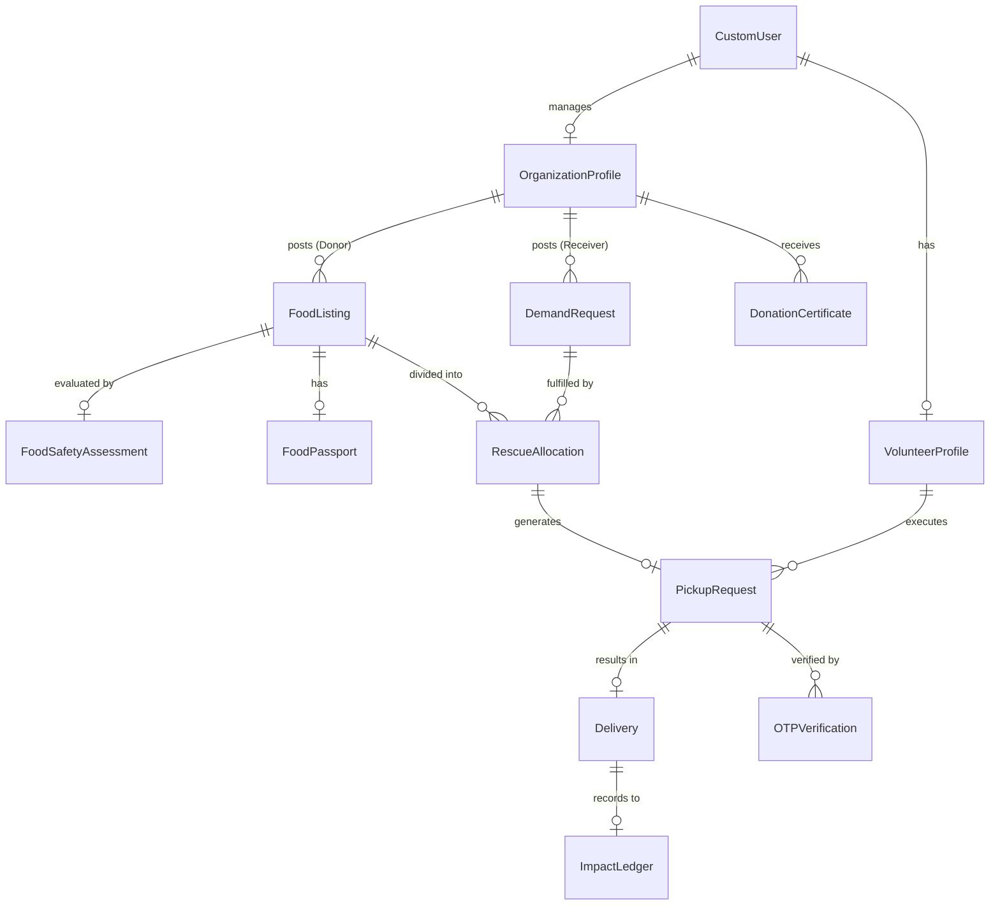

# SANJOG — Database Design & Data Dictionary Document
## Relational PostGIS Schema & Food Rescue OS Data Dictionary

---

### 1. DATABASE OVERVIEW
**SANJOG** utilizes PostgreSQL 16 with the PostGIS 3.4 spatial database extension. The relational schema adheres to 3rd Normal Form (3NF), utilizing PostGIS spatial points (`GEOGRAPHY(POINT,4326)`), GiST spatial indexing, and atomic reservation transaction locks (`select_for_update()`) to support multi-recipient allocations, digital food passports, and authoritative impact ledgers.

---

### 2. REVISED ER DIAGRAM (MERMAID)



---

### 3. COMPREHENSIVE DATA DICTIONARY (16 CORE ENTITIES)

#### Table 1: `accounts_customuser`
- **Purpose:** Core user account and role storage.
- **Fields:** `id` (UUID, PK), `username` (VARCHAR 150, Unique), `email` (VARCHAR 254, Unique), `password` (VARCHAR 128), `role` (Enum: `DONOR`, `RECEIVER`, `VOLUNTEER`, `ADMIN`), `phone_number` (VARCHAR 15), `is_active` (BOOL), `is_staff` (BOOL), `date_joined` (TIMESTAMPTZ).

#### Table 2: `organizations_organizationprofile`
- **Purpose:** Legal profile for Donors and Receivers.
- **Fields:** `id` (UUID, PK), `user_id` (FK `CustomUser`), `org_type` (Enum: `RESTAURANT`, `HOTEL`, `MESS`, `NGO`, `SHELTER`, etc.), `name` (VARCHAR 255), `registration_number` (VARCHAR 100, Unique), `address_line1` (TEXT), `city` (VARCHAR 100), `location` (GEOGRAPHY POINT 4326, GiST Index), `verification_status` (Enum: `PENDING`, `VERIFIED`, `REJECTED`), `rejection_reason` (TEXT), `created_at` (TIMESTAMPTZ).

#### Table 3: `organizations_organizationdocument`
- **Purpose:** Uploaded FSSAI and 80G legal accreditation files.
- **Fields:** `id` (UUID, PK), `organization_id` (FK `OrganizationProfile`), `document_type` (VARCHAR 50), `file_path` (VARCHAR 500), `uploaded_at` (TIMESTAMPTZ), `is_approved` (BOOL).

#### Table 4: `organizations_volunteerprofile`
- **Purpose:** Individual volunteer availability and vehicle details.
- **Fields:** `id` (UUID, PK), `user_id` (FK `CustomUser`), `vehicle_type` (Enum: `WALKING`, `BICYCLE`, `TWO_WHEELER`, `CAR`, `VAN`), `is_available` (BOOL, Index), `current_location` (GEOGRAPHY POINT 4326), `total_deliveries` (INT).

#### Table 5: `food_foodlisting`
- **Purpose:** Core surplus food entry. (*Updated: removed direct 1-to-1 `claimed_by` coupling*).
- **Fields:** `id` (UUID, PK), `donor_org_id` (FK `OrganizationProfile`), `title` (VARCHAR 200), `food_category` (Enum: `COOKED_MEAL`, `BAKERY`, `PACKAGED`, `RAW`), `food_type` (Enum: `VEG`, `NON_VEG`, `JAIN`, `VEGAN`), `total_servings` (INT), `remaining_servings` (INT, Index), `total_weight_kg` (NUMERIC 8,2), `cooked_at` (TIMESTAMPTZ), `expires_at` (TIMESTAMPTZ, Index), `location` (GEOGRAPHY POINT 4326, GiST Index), `status` (Enum: `AVAILABLE`, `PARTIALLY_ALLOCATED`, `FULLY_ALLOCATED`, `EXPIRED`, `CANCELLED`), `sla_tier` (Enum: `NORMAL`, `URGENT`, `CRITICAL`), `created_at` (TIMESTAMPTZ).

#### Table 6: `food_foodsafetyassessment` (NEW)
- **Purpose:** Structured food safety SOP rule evaluation.
- **Fields:** `id` (UUID, PK), `food_listing_id` (FK `FoodListing`, Unique), `storage_temperature` (VARCHAR 50), `packaging_type` (VARCHAR 50), `has_allergens` (BOOL), `hygiene_checklist_passed` (BOOL), `safety_status` (Enum: `ELIGIBLE`, `REVIEW_REQUIRED`, `NOT_ELIGIBLE`), `assessed_at` (TIMESTAMPTZ).

#### Table 7: `food_foodpassport` (NEW)
- **Purpose:** Immutable digital lifecycle chain-of-custody ledger.
- **Fields:** `id` (UUID, PK), `food_listing_id` (FK `FoodListing`, Unique), `passport_id` (VARCHAR 50, Unique), `custody_events_json` (JSONB), `current_hash` (VARCHAR 64), `is_finalized` (BOOL), `created_at` (TIMESTAMPTZ).

#### Table 8: `demand_demandrequest` (NEW)
- **Purpose:** Need-First meal requirements logged by Receivers.
- **Fields:** `id` (UUID, PK), `receiver_org_id` (FK `OrganizationProfile`), `servings_needed` (INT), `servings_fulfilled` (INT), `food_type_preference` (VARCHAR 20), `required_by` (TIMESTAMPTZ, Index), `delivery_location` (GEOGRAPHY POINT 4326, GiST Index), `status` (Enum: `ACTIVE`, `PARTIALLY_MATCHED`, `FULFILLED`, `EXPIRED`), `created_at` (TIMESTAMPTZ).

#### Table 9: `rescue_rescueallocation` (NEW - Multi-Recipient Split Junction)
- **Purpose:** Links one `FoodListing` to one `DemandRequest` for specific quantities.
- **Fields:** `id` (UUID, PK), `food_listing_id` (FK `FoodListing`), `demand_request_id` (FK `DemandRequest`), `allocated_servings` (INT), `allocated_weight_kg` (NUMERIC 8,2), `status` (Enum: `RESERVED`, `CONFIRMED`, `PICKUP_ASSIGNED`, `PICKED_UP`, `DELIVERED`, `CANCELLED`), `allocated_at` (TIMESTAMPTZ).

#### Table 10: `pickups_pickuprequest`
- **Purpose:** Volunteer transport tasks generated per `RescueAllocation`.
- **Fields:** `id` (UUID, PK), `allocation_id` (FK `RescueAllocation`, Unique), `volunteer_id` (FK `VolunteerProfile`, Nullable), `status` (Enum: `UNASSIGNED`, `ASSIGNED`, `PICKED_UP`, `DELIVERED`, `FAILED`), `assigned_at` (TIMESTAMPTZ), `picked_up_at` (TIMESTAMPTZ).

#### Table 11: `pickups_otpverification`
- **Purpose:** Cryptographic 4-digit OTP logs.
- **Fields:** `id` (UUID, PK), `pickup_request_id` (FK `PickupRequest`), `otp_type` (Enum: `PICKUP`, `DELIVERY`), `otp_hash` (VARCHAR 255), `attempts_count` (INT, Default 0), `is_verified` (BOOL), `expires_at` (TIMESTAMPTZ).

#### Table 12: `pickups_delivery`
- **Purpose:** Final delivery completion proof.
- **Fields:** `id` (UUID, PK), `pickup_request_id` (FK `PickupRequest`, Unique), `delivered_at` (TIMESTAMPTZ), `distance_km` (NUMERIC 6,2), `delivery_notes` (TEXT).

#### Table 13: `analytics_impactledger` (ENHANCED)
- **Purpose:** Authoritative financial & social impact transaction ledger.
- **Fields:** `id` (BIGSERIAL, PK), `delivery_id` (FK `Delivery`, Unique), `donor_org_id` (FK `OrganizationProfile`), `receiver_org_id` (FK `OrganizationProfile`), `servings_delivered` (INT), `weight_kg` (NUMERIC 8,2), `co2_offset_kg` (NUMERIC 8,2), `recorded_at` (TIMESTAMPTZ, Index).

#### Table 14: `certificates_donationcertificate`
- **Purpose:** Generated PDF metadata for corporate CSR validation.
- **Fields:** `id` (UUID, PK), `donor_org_id` (FK `OrganizationProfile`), `food_listing_id` (FK `FoodListing`), `certificate_hash` (VARCHAR 64, Unique), `pdf_file_path` (VARCHAR 500), `generated_at` (TIMESTAMPTZ).

#### Table 15: `audit_auditlog`
- **Purpose:** System-wide security and event auditing.
- **Fields:** `id` (BIGSERIAL, PK), `user_id` (FK `CustomUser`), `action` (VARCHAR 100), `target_model` (VARCHAR 100), `target_id` (VARCHAR 100), `ip_address` (INET), `timestamp` (TIMESTAMPTZ).

#### Table 16: `ml_engine_demandforecast` (P1)
- **Purpose:** Scikit-Learn ML demand forecasting baselines.
- **Fields:** `id` (UUID, PK), `receiver_org_id` (FK `OrganizationProfile`), `forecast_date` (DATE), `predicted_servings` (INT), `confidence_score` (NUMERIC 4,3), `generated_at` (TIMESTAMPTZ).

---

### 4. SQL CHECK CONSTRAINTS & CONCURRENCY
```sql
-- Enforce positive servings and weight
ALTER TABLE food_foodlisting ADD CONSTRAINT chk_food_servings CHECK (total_servings > 0 AND remaining_servings >= 0);
ALTER TABLE rescue_rescueallocation ADD CONSTRAINT chk_alloc_servings CHECK (allocated_servings > 0);

-- Enforce max 3 OTP attempts
ALTER TABLE pickups_otpverification ADD CONSTRAINT chk_otp_attempts CHECK (attempts_count <= 3);
```
