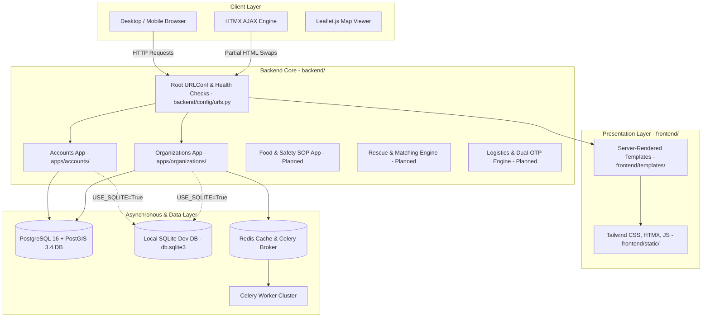

# SANJOG — Technical System Architecture Specification

> **Platform:** SANJOG — Intelligent Food Rescue Operating System (Food Rescue OS)  
> **Status:** OFFICIAL SYSTEM ARCHITECTURE SPECIFICATION  
> **Target Layout:** Restructured Dual-Stream Architecture (`frontend/` and `backend/`)

---

## 1. ARCHITECTURAL OVERVIEW

**SANJOG** is an operational Food Rescue Operating System engineered to eliminate surplus food waste through algorithmic need-first matching, multi-recipient allocation, food safety SOP validation, and verifiable chain-of-custody tracking.

The system combines:
1. **Frontend Presentation Stream (`frontend/`):**
   - High-visibility operational UI built with Django server-rendered HTML templates.
   - Dynamic real-time swaps and interactions powered by HTMX (zero full-page reloads for operational dashboards).
   - Tailwind CSS utility styling configured with brand tokens for operational state visibility (`Primary` green, `Secondary` amber warning, `Urgent` red alert).
   - Interactive spatial radar and tracking rendered via Leaflet.js and OpenStreetMap.
2. **Backend Application Stream (`backend/`):**
   - Modular Django 5.x application core (`apps/accounts`, `apps/organizations`, etc.).
   - Headless REST APIs (`/api/v1/`) powered by Django REST Framework with Token & Session auth and scoped throttling.
   - Spatial persistence engine using PostgreSQL 16 + PostGIS 3.4 with an active SQLite development fallback.
   - Asynchronous worker cluster managed by Celery 5.3+ and Redis 5.0+.
   - Cryptographic Food Passport Ledger engine calculating SHA-256 state hashes across all custody handoffs.

---

## 2. HIGH-LEVEL SYSTEM TOPOLOGY

---

## 3. SEPARATION OF CONCERNS & BOUNDARY RULES

### 3.1 Frontend Stream Boundary (`frontend/`)
The frontend developer works primarily within `frontend/`:
- **Django HTML Templates:** `frontend/templates/` (base layouts, role dashboards, organization onboarding, document verification queue, admin review detail).
- **Reusable Components:** `frontend/templates/components/` (navigation bar, badges, modal dialogs, status cards).
- **Presentation Styling:** `frontend/static/css/` (Tailwind entrypoint, CSS keyframes, responsive rules).
- **Client Interactions:** `frontend/static/js/` (HTMX, Leaflet map initializers, form validations).
- **Boundary Constraint:** The frontend developer must never directly modify database models, migrations, authentication logic, permission classes, or backend environment secrets.

### 3.2 Backend Stream Boundary (`backend/`)
The backend developer works primarily within `backend/`:
- **Django Settings & URLs:** `backend/config/` (settings modularized for development and production).
- **Django Applications:** `backend/apps/` (`accounts`, `organizations`, future apps).
- **Data Models & Schema:** `models.py`, database indexes, spatial fields.
- **Database Migrations:** Sole authority for generating and applying migrations.
- **REST APIs:** `api_views.py`, `serializers.py`, `permissions.py`.
- **Business Services:** `services.py`, validation rules, atomic database transactions.
- **Testing:** `backend/tests/` (unit, integration, and security test suites).

---

## 4. SECURITY & DATA GOVERNANCE

1. **Role-Based Access Control (RBAC):**
   - Four distinct user roles: `DONOR`, `RECEIVER`, `VOLUNTEER`, `ADMIN`.
   - Access enforced via view decorators (`@role_required`, `@admin_required`) and DRF permission classes (`IsAdminUser`, `IsOrganizationOwner`).
2. **Private Document Storage:**
   - Legal verification documents (FSSAI licenses, 80G certificates) are stored in `private_media/` outside the web server's public document root.
   - Download access requires active authentication and owner/admin authorization.
   - Served via secure streaming `FileResponse` with `X-Content-Type-Options: nosniff` headers.
3. **Audit Trail & Immutability:**
   - Admin verification events are recorded in `OrganizationVerificationEvent` using an append-only pattern.
   - Deletion or mutation of audit records is blocked at both model and queryset levels.
